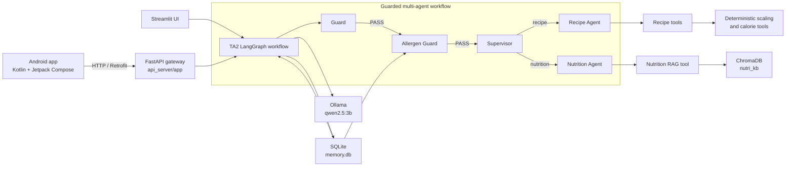

# NutriScale - AI-Powered Nutrition & Recipe Scaling Assistant


NutriScale is a local, multi-agent nutrition application that combines deterministic recipe calculations, RAG-based nutrition lookup, persistent allergy management, and a native Android client.

The project includes:

- a TA1 baseline Streamlit agent and tool implementation;
- a TA2 LangGraph multi-agent system with guard nodes, RAG, SQLite memory, and trace data;
- a FastAPI mobile gateway;
- an Android app built with Kotlin and Jetpack Compose.

LLM inference and the project knowledge base run locally. NutriScale does not require a cloud model API key.

## Table of Contents

- [Key Features](#key-features)
- [System Architecture](#system-architecture)
- [Multi-Agent Workflow](#multi-agent-workflow)
- [Recipe Scaling](#recipe-scaling)
- [RAG-Based Nutrition Assistant](#rag-based-nutrition-assistant)
- [Allergy Management and Safety](#allergy-management-and-safety)
- [Tech Stack](#tech-stack)
- [Repository Structure](#repository-structure)
- [Backend API](#backend-api)
- [Prerequisites](#prerequisites)
- [Installation](#installation)
- [Running NutriScale](#running-nutriscale)
- [Android App Setup](#android-app-setup)
- [Testing](#testing)
- [Demo](#demo)
- [Current Limitations](#current-limitations)

## Key Features

- **Deterministic recipe scaling** using `scale_recipe(servings_original, servings_target, ingredient_amount)`.
- **Sequential calorie estimation** that uses the scaled quantity, not the original quantity.
- **RAG-grounded nutrition answers** from local documents for rice, chicken, and pasta.
- **Explicit unknown handling** for ingredients that are not present in the local knowledge base.
- **Guarded execution** for negative quantities, unsupported medical keywords, ambiguous ingredients, and declared allergens.
- **Persistent user preferences and allergens** in the TA2 SQLite database.
- **Thread-level conversation memory** using LangGraph `MemorySaver`.
- **Execution traces** showing guard decisions, routing, agent activity, and timing.
- **Native Android interface** for recipe scaling, chat, health status, and allergy management.
- **FastAPI endpoints** for Android and other local HTTP clients.

## System Architecture



The `scale` API can also perform direct scaling and RAG calorie lookup without invoking the conversational agent graph. The `chat` API calls the full LangGraph workflow.

## Multi-Agent Workflow

### 1. Guard

The input guard checks for:

- negative numeric values;
- unsupported medical or clinical claims containing keywords such as `cure`, `treat`, `diagnose`, `medic`, `prescription`, or `disease`.

A blocked request terminates before the supervisor or agents run.

### 2. Allergen Guard

The allergen guard loads declared allergies for the supplied `user_id` from `ta2/memory.db`. It checks exact allergen names and configured aliases, for example:

- `dairy`, `milk`, `cheese`, `butter`, `cream`, `yogurt`;
- `gluten`, `wheat`, `barley`, `rye`, `bread`, `flour`;
- `peanut`, `peanuts`, `groundnut`, `peanut butter`.

It also blocks requests containing words such as `unknown`, `mystery`, or `unnamed`.

### 3. Supervisor

The supervisor routes a request to:

- `recipe` for scaling or serving changes;
- `nutrition` for nutrition and calorie questions.

The graph recursion limit is 10 hops.

### 4. Recipe Agent

The recipe agent is instructed to call `scale_recipe` first and pass the resulting scaled quantity to `estimate_calories` second. This prevents the common 200 g to 260 kcal error in the canonical 200 g, 4-to-8-serving example.

### 5. Nutrition Agent

The nutrition agent uses `retrieve_nutrition_info`, searches ChromaDB for the most relevant local reference documents, and cites the retrieved source in its response. It returns an unknown or unavailable message for missing reference data instead of inventing values.

## Recipe Scaling

The scaling formula is:

```text
scaled_amount = original_amount × (target_servings / original_servings)
```

### Verified example

For 200 g of rice:

- original servings: `4`
- target servings: `8`
- scale factor: `8 / 4 = 2`
- scaled amount: `200 × 2 = 400 g`
- rice calorie density: `1.3 kcal/g`
- estimated calories: `400 × 1.3 = 520 kcal`

The TA2 implementation also provides `rag_scale_and_estimate`, while the direct `/scale` API retrieves a supported ingredient's density from RAG and calculates:

```text
estimated_calories = scaled_amount × calorie_density
```

For an ingredient outside the current knowledge base, the API keeps the scaled quantity but returns `is_rag_verified: false`, `estimated_calories: null`, and `calorie_density: null`.

## RAG-Based Nutrition Assistant

The RAG implementation is lazy-loaded by `ta2/ta2_tools.py`:

1. TextLoader reads `.txt` files from `ta2/knowledge/`.
2. `CharacterTextSplitter` creates document chunks.
3. Ollama `nomic-embed-text` embeddings populate a Chroma collection.
4. The persistent database is stored in `ta2/chroma_db/`.
5. Nutrition queries retrieve two relevant documents for general retrieval.
6. Calorie-density lookup retrieves the most relevant document and extracts a `kcal per gram` value.

The bundled references cover:

- cooked white rice;
- cooked/raw chicken breast;
- dry and cooked pasta.

Retrieved information is explicitly reference data and is accompanied by a disclaimer rather than being presented as a medically precise value.

## Allergy Management and Safety

Persistent allergy records are stored in SQLite under the `allergies` table in `ta2/memory.db`. The Android app and API provide get, add, and remove operations for allergens.

Safety behavior includes:

- input validation for non-positive servings and negative amounts;
- request-level keyword and negative-number blocking;
- declared-allergy and alias matching;
- ambiguity blocking for unknown or unnamed ingredients;
- explicit `UNKNOWN` results for missing RAG ingredients;
- source attribution for RAG-grounded calorie responses.

These guards are helpful safety aids, not a substitute for professional dietary or medical guidance.

## Tech Stack

| Area | Technology |
|---|---|
| Language | Python |
| Baseline UI | Streamlit |
| Backend API | FastAPI, Uvicorn, Pydantic |
| Agent framework | LangGraph, LangChain |
| Local LLM | Ollama, `qwen2.5:3b` |
| Embeddings / RAG | Ollama `nomic-embed-text`, ChromaDB |
| Persistent memory | SQLite (`ta2/memory.db`) |
| Android language | Kotlin |
| Android UI | Jetpack Compose, Material 3 |
| Android navigation | Navigation Compose |
| Android networking | Retrofit, OkHttp, Gson |

The Android app targets API 34, supports a minimum SDK of 24, and uses Java/Kotlin target 17.

## Repository Structure

```text
NutriScale/
├── app.py                         # TA1 Streamlit application
├── tools.py                       # TA1 LangChain tools
├── run_agent_demo.py              # Annotated TA1 CLI demo
├── test_tools.py                  # 15-case tool test script
├── requirements.txt               # TA1 Python dependencies
├── ta1/                           # Frozen TA1 source snapshot
├── ta2/
│   ├── prototype.py               # LangGraph workflow and SQLite memory
│   ├── ta2_tools.py               # Recipe, calorie, and RAG tools
│   ├── streamlit_app.py           # TA2 dashboard
│   ├── memory.db                  # Persistent preferences/allergies
│   ├── knowledge/                 # Rice, chicken, and pasta references
│   ├── chroma_db/                 # Persistent ChromaDB data
│   ├── tests/                     # Regression and evaluation scripts
│   └── results/                   # Saved evaluations and traces
├── api_server/
│   ├── app/main.py                # FastAPI application
│   ├── app/schemas.py             # Pydantic request/response models
│   ├── app/core/config.py         # Ollama and project paths
│   ├── app/services/              # Bridge to TA2 components
│   └── test_e2e_api.py            # API end-to-end test script
└── android-app/
    └── app/src/main/
        ├── java/com/nutriscale/app/
        └── AndroidManifest.xml
```

## Backend API

Start the API with Uvicorn and use the following endpoints.

| Method | Path | Purpose |
|---|---|---|
| `GET` | `/health` | Ollama connectivity and LangGraph initialization status |
| `POST` | `/scale` | Deterministic scaling, stored-allergen check, and RAG calorie lookup |
| `POST` | `/chat` | Guarded conversational LangGraph workflow |
| `GET` | `/allergies/{user_id}` | Load a user's allergies |
| `POST` | `/allergies` | Add an allergy using a JSON body |
| `POST` | `/allergies/{user_id}` | Add an allergy using a path user ID |
| `POST` | `/allergies/remove` | Remove an allergy using a JSON body |
| `DELETE` | `/allergies/{user_id}/{allergen}` | Remove an allergy using path parameters |

Interactive OpenAPI documentation is available at `/docs` when the FastAPI server is running.

### Example `/scale` request

```json
{
  "ingredient_name": "rice",
  "original_amount": 200.0,
  "original_servings": 4.0,
  "target_servings": 8.0,
  "user_id": "demo_user"
}
```

### Example `/chat` request

```json
{
  "message": "What are the calories in 100g of white rice?",
  "user_id": "demo_user",
  "thread_id": "thread_session_1"
}
```

## Prerequisites

- Windows, macOS, or Linux
- Python 3.10 or newer
- [Ollama](https://ollama.com/) running locally
- JDK 17 for the Android project
- Android Studio for the Android app

The repository's Python manifests do not pin exact Python patch versions. The Android Gradle wrapper uses Gradle 8.1.1 and the Android plugin 8.1.1.

## Installation

Clone or open the repository, then open a terminal at the project root.

```powershell
cd W:\Ayoo\NutriScale
python -m pip install -r ta2\requirements.txt
python -m pip install -r api_server\requirements.txt
```

Pull the required Ollama models:

```powershell
ollama pull qwen2.5:3b
ollama pull nomic-embed-text
```

Verify availability:

```powershell
ollama list
```

## Running NutriScale

### TA2 Streamlit UI

```powershell
cd W:\Ayoo\NutriScale
streamlit run ta2\streamlit_app.py
```

### TA1 Streamlit UI

```powershell
cd W:\Ayoo\NutriScale
streamlit run app.py
```

### TA1 annotated CLI demo

```powershell
cd W:\Ayoo\NutriScale
python -X utf8 run_agent_demo.py
```

### FastAPI gateway

```powershell
cd W:\Ayoo\NutriScale\api_server
python -m uvicorn app.main:app --host 0.0.0.0 --port 8000
```

Health check:

```powershell
curl http://127.0.0.1:8000/health
```

## Android App Setup

### Emulator

The app defaults to `http://10.0.2.2:8000/`. Android Emulator uses this address to reach the host machine's local port.

From Android Studio:

1. Open `android-app/` as the Gradle project.
2. Let Gradle synchronize.
3. Start the FastAPI server on the host machine.
4. Start an emulator and run the `app` configuration.

### Physical Android device

1. Connect the phone and laptop to the same network.
2. Start FastAPI on `0.0.0.0:8000`.
3. Find the laptop's active Wi-Fi IPv4 address using `ipconfig`.
4. Open the app's **Profile & Settings** screen.
5. Enter `http://<LAPTOP_IPV4>:8000/` in **Base URL** and save it.

The app allows cleartext HTTP and includes an emulator and localhost preset. It also exposes a Wi-Fi preset field that can be replaced with the device's reachable laptop address.

From the command line:

```powershell
cd W:\Ayoo\NutriScale\android-app
.\gradlew.bat assembleDebug
```

The debug APK is generated under `android-app/app/build/outputs/apk/debug/`.

## Testing

### Root TA1 tool tests

```powershell
cd W:\Ayoo\NutriScale
python -X utf8 test_tools.py
```

Verified result: 15 of 15 cases passed.

### TA2 scaling regression

```powershell
python -X utf8 ta2\tests\test_scaling_calorie_regression.py
```

This verifies that 200 g scaled from 4 to 8 servings becomes 400 g and produces 520 kcal at 1.3 kcal/g.

### Additional repository test scripts

```powershell
python -X utf8 ta2\tests\allergen_tests.py
python -X utf8 ta2\tests\scaling_critic.py
python -X utf8 ta2\tests\rag_vs_manual.py
python -X utf8 ta2\tests\eval_both.py
```

### FastAPI end-to-end test

Start Ollama and the FastAPI server first, then run:

```powershell
cd W:\Ayoo\NutriScale\api_server
python -X utf8 test_e2e_api.py
```

The script exercises health, scaling, RAG source attribution, chat, persistent allergies, conversation continuity, guard behavior, and unknown ingredients.

### Android test assembly

```powershell
cd W:\Ayoo\NutriScale\android-app
.\gradlew.bat test
```

This runs the Android local JVM test task; it does not require the emulator.

## Demo

### 1. Start the local backend

```powershell
ollama serve
```

In another terminal:

```powershell
cd W:\Ayoo\NutriScale\api_server
python -m uvicorn app.main:app --host 0.0.0.0 --port 8000
```

### 2. Try recipe scaling

Open `/docs` or call `/scale` with:

- ingredient: `rice`
- original amount: `200`
- original servings: `4`
- target servings: `8`

The response should report a scale factor of `2`, a scaled amount of `400 g`, a density of `1.3 kcal/g`, and `520 kcal` for the bundled rice reference.

### 3. Try the nutrition assistant

Ask through `/chat` or the Android chat screen:

```text
What are the calories in 100g of white rice?
```

### 4. Try the safety guard

Save `dairy` as an allergy for a user, then submit a recipe containing `milk` or another configured alias. The allergen guard should block the request before scaling.

### 5. Open the Streamlit trace UI

```powershell
streamlit run ta2\streamlit_app.py
```

Use the dashboard to inspect route selection, guard decisions, response traces, SQLite memory, and RAG lookup behavior.

## Current Limitations

- The bundled RAG corpus contains only rice, chicken, and pasta reference files. Other ingredients can return `UNKNOWN` or `is_rag_verified: false`.
- The allergen implementation uses a small alias table and exact word matching. It does not provide a complete allergy ontology or detect every culinary derivative.
- Nutrition values are reference estimates, not medically precise measurements.
- Short-term conversation memory is scoped by LangGraph thread configuration; SQLite is used for persistent preferences and allergies.
- Ollama startup and model availability are local prerequisites. `/health` reports degraded status when Ollama is unavailable.
- Chroma and embedding setup occur lazily in the tools and require `nomic-embed-text` to be available locally.
- The Streamlit and FastAPI experiences are designed for local or LAN use, not as a public production deployment.
