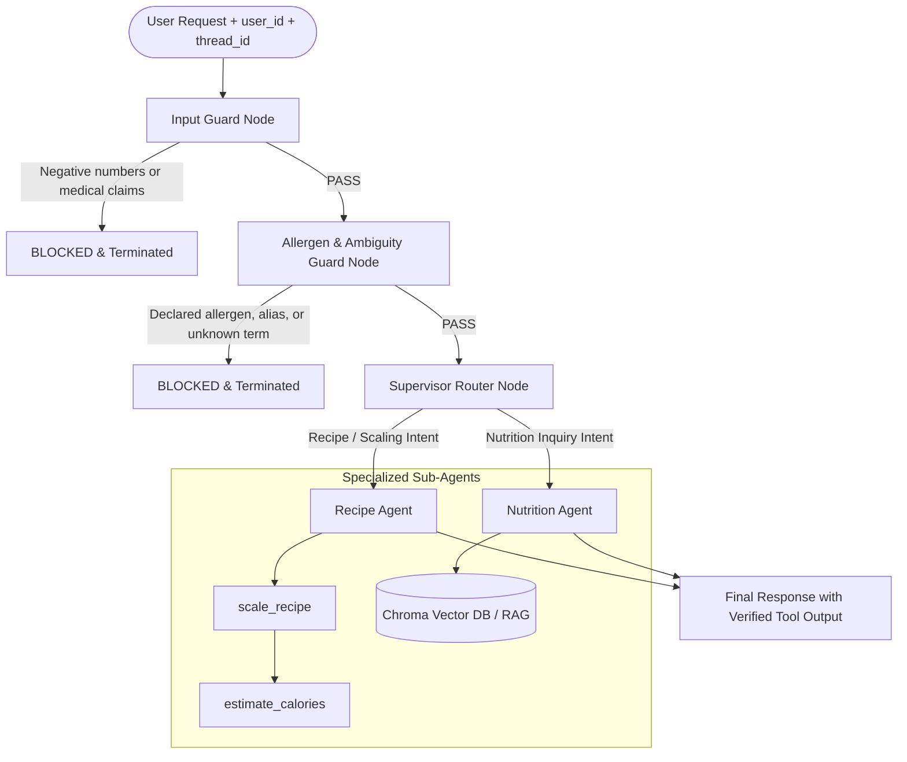

# NutriScale — Recipe Scaler & Nutrition Estimator

NutriScale is an Agentic AI application built for a college jury project. It translates natural-language cooking requests into exact, deterministic recipe adjustments and nutritional evaluations without requiring users to orchestrate tool sequences manually.

The project encompasses two stages:
1. **TA1 (Baseline):** A single-agent autonomous tool-calling loop using LangChain, Ollama (`qwen2.5:3b`), and Streamlit.
2. **TA2 (Extension):** A stateful, multi-agent architecture built with LangGraph, introducing persistent SQLite memory, local Chroma vector search (RAG via `nomic-embed-text`), an allergen and ambiguity safety guard, and an independent mathematical scaling critic.

---

## Table of Contents

- [Project Overview](#project-overview)
- [Evolution: TA1 vs. TA2](#evolution-ta1-vs-ta2)
- [TA1 — Original Baseline Implementation](#ta1--original-baseline-implementation)
- [TA2 — Multi-Agent Architecture](#ta2--multi-agent-architecture)
- [Walkthrough Example](#walkthrough-example)
- [Repository Structure](#repository-structure)
- [Installation and Setup](#installation-and-setup)
- [How to Run](#how-to-run)
- [Test Results and Verification](#test-results-and-verification)
- [Current Limitations and Future Work](#current-limitations-and-future-work)
- [Team Handover and Git Status](#team-handover-and-git-status)

---

## Project Overview

Recipe preparation often requires scaling batch sizes while monitoring nutritional intake. Manual calculations are prone to arithmetic errors, while general-purpose large language models (LLMs) frequently hallucinate quantities or struggle with chained mathematical reasoning.

NutriScale addresses this by combining the natural-language comprehension of an LLM with deterministic Python calculation tools and grounded local knowledge retrieval:
- **Local Inference:** Fully private execution using Ollama with `qwen2.5:3b` and `nomic-embed-text`. No cloud APIs or external API keys are required.
- **Autonomous Multi-Agent Loop:** The system inspects user requests, routes to specialized agents, executes tools sequentially, and preserves exact mathematical results.
- **Safety Gating:** Pre-execution checks block harmful queries, impossible quantities (e.g., negative amounts), declared allergens, and ambiguous ingredients before any calculation begins.

---

## Evolution: TA1 vs. TA2

The project evolved from a single autonomous agent into a modular multi-agent system with defensive gating and long-term memory:

| Aspect | TA1 — Original Baseline | TA2 — Multi-Agent Extension | Why It Matters |
|---|---|---|---|
| **Architecture** | Single-agent ReAct loop (`create_agent`) | Multi-node `StateGraph` with explicit gating and routing | Separates safety validation, intent routing, and agent tasks |
| **Agent Roles** | 1 general agent executing both tools | 2 specialized agents: `recipe_agent` & `nutrition_agent` | Clear division of responsibilities prevents prompt confusion |
| **Orchestration** | Implicit loop inside LangGraph prebuilt agent | Deterministic supervisor node + recursion hop limit (max 10) | Prevents infinite agent loops and controls execution flow |
| **Nutrition Lookup** | Hardcoded or user-supplied calorie densities | Chroma vector database (RAG) using `nomic-embed-text` | Grounded in verified local reference documents |
| **Missing Ingredients** | Model or user supplied density directly | Explicit `UNKNOWN` returned; model guessing is forbidden | Eliminates nutritional hallucinations |
| **Safety Validation** | Basic parameter validation inside tools | Two-tier pre-execution guards (Input Guard + Allergen Guard) | Blocks dangerous/invalid requests before tools execute |
| **Allergen Checks** | None | SQLite-backed allergen matching with synonym/alias expansion | Prevents serving recipes matching declared user allergies |
| **Memory** | Stateless (no memory between requests) | Thread memory (`MemorySaver`) + persistent SQLite (`memory.db`) | Context persists across turns and application restarts |
| **Arithmetic Integrity** | Relied on LLM narrative response | Deterministic tool output extracted and enforced in final answer | Prevents small-model arithmetic paraphrase drift |
| **Result Verification**| None | Independent Scaling Critic verifying tolerance (1.0%) | Validates tool output against a pure formula baseline |
| **User Interface** | Single-page Streamlit app (`app.py`) | Enhanced dashboard (`ta2/streamlit_app.py`) with memory & audit | Full visibility into safety guards, traces, and metrics |

---

## TA1 — Original Baseline Implementation

TA1 represents the original project deliverable preserved in both the root directory (`app.py`, `tools.py`, `test_tools.py`, `run_agent_demo.py`) and as a frozen snapshot in `ta1/`.

### Architecture & Tools
TA1 uses `create_agent` from `langchain.agents` backed by LangGraph:
1. `scale_recipe(servings_original, servings_target, ingredient_amount)`:
   $$\text{scaled\_amount} = \text{ingredient\_amount} \times \left(\frac{\text{servings\_target}}{\text{servings\_original}}\right)$$
2. `estimate_calories(ingredient_amount, calories_per_unit)`:
   $$\text{total\_calories} = \text{ingredient\_amount} \times \text{calories\_per_unit}$$

The agent receives a single natural-language prompt, autonomously calls `scale_recipe`, feeds the resulting amount into `estimate_calories`, and outputs the final text.

### Testing & Validation
All inputs are validated against zero servings, negative servings, and negative quantities. TA1 includes 15 automated unit tests in `test_tools.py`, all of which pass (15/15).

---

## TA2 — Multi-Agent Architecture

TA2 replaces the single-agent pipeline with a modular `StateGraph` combining defensive gating, two specialized agents, and memory.



### Components and Responsibilities

1. **Input Guard (`guard_node`):**
   - Scans raw request for negative numeric quantities (`-\d+`).
   - Scans for unsupported medical/clinical claims (`cure`, `treat`, `diagnose`, `prescription`, `disease`).
   - Halts execution immediately if triggered.

2. **Allergen & Ambiguity Guard (`allergen_guard_node`):**
   - Reads declared user allergies from the persistent SQLite store.
   - Evaluates request text against stored allergens and culinary aliases (`dairy` $\leftrightarrow$ `milk`/`cheese`/`butter`, `gluten` $\leftrightarrow$ `wheat`/`flour`/`bread`, `peanut` $\leftrightarrow$ `groundnut`, `soy`, `egg`).
   - Uses regex word-boundary matching (`\b`) to prevent false-positive substring collisions.
   - Rejects ambiguous or unspecified food requests (e.g., "unknown mystery ingredient") with an explicit `UNKNOWN` classification.

3. **Supervisor Router (`supervisor_node`):**
   - Inspects cleaned request intent.
   - Routes scaling and composite recipe requests to the `recipe_agent`.
   - Routes pure nutritional queries to the `nutrition_agent`.
   - Enforces a recursion limit of 10 hops to prevent infinite execution loops.

4. **Recipe Agent (`recipe_agent`):**
   - Configured with strict sequential execution constraints: invokes `scale_recipe` first, waits for the observation, and passes the scaled quantity to `estimate_calories`.
   - Never uses original input quantities for calorie estimation.

5. **Nutrition Agent (`nutrition_agent`):**
   - Grounded in local reference documents using Chroma and `nomic-embed-text`.
   - Extracts calorie density and macro summaries with explicit food state attribution (cooked vs. raw).
   - Returns explicit `UNKNOWN` if an ingredient is missing from the local corpus.

6. **Independent Scaling Critic (`scaling_critic.py`):**
   - A standalone Python evaluation module that independently re-computes:
     $$\text{expected} = \frac{\text{original\_amount} \times \text{target\_servings}}{\text{original\_servings}}$$
   - Verifies agent tool output against an allowed 1.0% tolerance, flagging any injected deviation as a `FAIL`.
   - Safely catches invalid or negative parameters as `INVALID_INPUT`.

7. **Memory Architecture:**
   - **Short-Term Memory:** LangGraph `MemorySaver` preserves conversational context within a session thread (`thread_id`).
   - **Long-Term Memory:** SQLite database (`ta2/memory.db`) persists `prefs` (e.g., dietary style) and `allergies` (declared allergens) across process restarts.

8. **Deterministic Arithmetic Output:**
   - Small models (such as `qwen2.5:3b`) can experience narrative paraphrase drift during text generation.
   - TA2 extracts the deterministic `ToolMessage` calculation and explicitly binds it to the output string (`[Tool output] Estimated calories: 520.00 kcal`), ensuring calculated truth is always presented.

9. **Prototype Size Constraint:**
   - `ta2/prototype.py` contains **113 physical lines** (95 executable lines), fully complying with the academic constraint of **$\le$120 lines**.

---

## Walkthrough Example

Consider the standard evaluation request:
> *"Scale 200g of rice from 4 servings to 8 servings. Calories per gram: 1.3."*

```
User Request: 200g cooked white rice (4 -> 8 servings, 1.3 kcal/g)
  │
  ├── 1. Input Guard: No negative numbers, no medical claims -> PASS
  ├── 2. Allergen Guard: User allergies checked (no match) -> PASS
  ├── 3. Supervisor: Scaling intent detected -> Routes to Recipe Agent
  ├── 4. Tool Execution (Step 1):
  │      scale_recipe(amount=200, orig_serv=4, target_serv=8)
  │      --> Scaled Amount: 400.00 g (Factor: 2.0x)
  ├── 5. Tool Execution (Step 2 - Sequential):
  │      estimate_calories(amount=400.00, calories_per_unit=1.3)
  │      --> Total Calories: 520.00 kcal (400.00 x 1.3)
  └── 6. Final Verified Response:
         Scaled quantity: 400.00 g
         Estimated calories: 520.00 kcal
         [Tool output] Estimated calories: 520.00 kcal (400.00 units x 1.3 kcal/unit = 520.00 kcal)
```

**Sequential Dependency Rule:** `estimate_calories` must receive 400g (the scaled amount). If an agent passes the original 200g, it incorrectly outputs 260 kcal. TA2's prompt sequencing and regression suite guarantee the 400g input.

---

## Repository Structure

```
NutriScale/
├── app.py                         # TA1 Streamlit interface (frozen baseline)
├── tools.py                       # TA1 tools: scale_recipe, estimate_calories
├── run_agent_demo.py              # TA1 CLI demo script
├── test_tools.py                  # TA1 unit test suite (15 test cases)
├── requirements.txt               # TA1 Python dependencies
├── README.md                      # Root documentation (this file)
│
├── ta1/                           # Bit-identical frozen backup of TA1
│   ├── app.py
│   ├── tools.py
│   ├── run_agent_demo.py
│   ├── test_tools.py
│   ├── requirements.txt
│   └── README.md
│
└── ta2/                           # TA2 Multi-Agent Extension
    ├── prototype.py               # Core multi-agent execution graph (113 physical lines)
    ├── ta2_tools.py               # TA2 tools, Chroma RAG integration, and helper functions
    ├── streamlit_app.py           # TA2 modern Streamlit dashboard
    ├── requirements.txt           # TA2 Python dependencies
    ├── README.md                  # TA2-specific documentation
    ├── memory.db                  # Persistent SQLite store (prefs and allergies tables)
    ├── scratch_db_inspect.py      # Diagnostic script for SQLite inspection
    │
    ├── chroma_db/                 # Persistent Chroma vector store
    │   └── chroma.sqlite3
    │
    ├── knowledge/                 # Local RAG knowledge base documents
    │   ├── rice_nutrition.txt     # Cooked white rice reference (1.3 kcal/g)
    │   ├── chicken_nutrition.txt  # Cooked chicken breast (1.65 kcal/g) vs raw (1.1 kcal/g)
    │   └── pasta_nutrition.txt    # Dry pasta (3.5 kcal/g) vs cooked pasta (1.3-1.6 kcal/g)
    │
    ├── tests/                     # TA2 automated test suites
    │   ├── test_scaling_calorie_regression.py  # Regression test for sequential 400g -> 520 kcal
    │   ├── allergen_tests.py      # 4-case allergen & ambiguity suite
    │   ├── scaling_critic.py      # Independent mathematical scaling critic
    │   ├── rag_vs_manual.py       # RAG comparison against manual baselines
    │   └── eval_both.py           # 5-case comparative evaluation (TA1 vs TA2)
    │
    └── results/                   # Evaluation outputs and saved execution traces
        ├── ta1_results.json       # Structured TA1 evaluation output
        ├── ta2_results.json       # Structured TA2 evaluation output
        ├── rag_vs_manual.json     # RAG vs manual numerical comparisons
        └── traces/
            ├── allergen_tests_trace.json
            ├── scaling_critic_trace.json
            ├── tc1_trace.json     # Basic recipe scaling trace
            ├── tc2_trace.json     # RAG nutrition inquiry trace
            ├── tc3_trace.json     # Thread memory follow-up trace
            ├── tc4_trace.json     # Long-term SQLite memory recall trace
            └── tc5_trace.json     # Guard negative rejection trace
```

---

## Installation and Setup

### Prerequisites
- Python 3.10 to 3.14 on Windows (PowerShell).
- [Ollama](https://ollama.com/) installed and added to your system `PATH`.

### Step 1: Clone or Navigate to the Workspace
```powershell
cd W:\Ayoo\NutriScale
```

### Step 2: Install Python Dependencies
```powershell
pip install -r ta2/requirements.txt
```
*(Dependencies include `langchain`, `langgraph`, `langchain-ollama`, `chromadb`, `langchain-community`, and `streamlit`.)*

### Step 3: Verify and Pull Ollama Models
Ensure your local Ollama daemon is active. If Ollama is already running at `http://127.0.0.1:11434`, do not start a second instance.

Verify or pull the required models:
```powershell
ollama pull qwen2.5:3b
ollama pull nomic-embed-text
```

Verify available models:
```powershell
ollama list
```
*(You should see `qwen2.5:3b` and `nomic-embed-text:latest`.)*

---

## How to Run

### 1. Launch the TA2 Streamlit Dashboard
```powershell
cd W:\Ayoo\NutriScale
streamlit run ta2/streamlit_app.py
```
*Features interactive recipe input, allergen guard indicators, scaling preview, live agent trace inspection, and SQLite memory management.*

### 2. Launch the Frozen TA1 Baseline Dashboard
```powershell
cd W:\Ayoo\NutriScale
streamlit run app.py --server.port 8501
```
*(If running both simultaneously, specify different ports, e.g., `--server.port 8501` and `--server.port 8502`.)*

### 3. Run the TA1 CLI Demonstration
```powershell
cd W:\Ayoo\NutriScale
python -X utf8 run_agent_demo.py
```

### 4. Run the Test Suites

#### A. TA2 Scaling-to-Calorie Regression Test
Verifies that `estimate_calories` receives the scaled 400g input rather than the original 200g:
```powershell
python -X utf8 ta2/tests/test_scaling_calorie_regression.py
```

#### B. Allergen and Ambiguity Guard Tests
Executes 4 live test cases (Direct Match, Safe Ingredient, Ambiguity Block, Alias Match):
```powershell
python -X utf8 ta2/tests/allergen_tests.py
```

#### C. Independent Scaling Critic
Executes formula checks across normal scaling, a deliberately injected 100g error, and invalid inputs:
```powershell
python -X utf8 ta2/tests/scaling_critic.py
```

#### D. RAG vs. Manual Calorie Comparison
Compares RAG retrieved values with manual baselines and verifies `UNKNOWN` handling for missing foods:
```powershell
python -X utf8 ta2/tests/rag_vs_manual.py
```

#### E. End-to-End Comparative Evaluation (TA1 vs. TA2)
Runs the standardized 5-case evaluation against both implementations:
```powershell
python -X utf8 ta2/tests/eval_both.py
```

#### F. TA1 Frozen Baseline Unit Tests
Verifies that TA1 remains completely functional:
```powershell
python -X utf8 ta1/test_tools.py
```

---

## Test Results and Verification

All tests were executed directly in PowerShell. Below are the verified results:

| Test Suite | Command | Cases | Result |
|---|---|:---:|:---:|
| **TA1 Tool Unit Tests** | `ta1/test_tools.py` | 15 | **15/15 PASS** |
| **Scaling Regression** | `ta2/tests/test_scaling_calorie_regression.py` | 1 | **PASS** (400g $\rightarrow$ 520 kcal) |
| **Allergen Guard** | `ta2/tests/allergen_tests.py` | 4 | **4/4 PASS** |
| **Scaling Critic** | `ta2/tests/scaling_critic.py` | 6 | **6/6 PASS** (caught injected error) |
| **RAG vs Manual** | `ta2/tests/rag_vs_manual.py` | 3 | **3/3 PASS** |
| **Comparative Suite** | `ta2/tests/eval_both.py` | 5 | **TA1: 3/5 PASS (2 N/A)**<br>**TA2: 5/5 PASS (100%)** |

### Breakdown of the 5 Comparative Cases (`eval_both.py`)
1. **TC1 — Recipe Scaling & Calorie Estimation:** Both pass. TA2 enforces deterministic tool output in final answer.
2. **TC2 — RAG Reference Inquiry:** TA1 uses fixed parameters; TA2 retrieves from `chicken_nutrition.txt` via Chroma.
3. **TC3 — Short-Term Thread Memory:** TA1 lacks memory (N/A); TA2 successfully recalls scaled quantities from prior turn via `thread_id`.
4. **TC4 — Long-Term Memory Recall:** TA1 lacks persistence (N/A); TA2 recalls user preferences from SQLite in a fresh thread.
5. **TC5 — Negative Value Rejection:** Both pass. TA1 rejects within tool; TA2 gates at the graph entry guard.

---

## Current Limitations and Future Work

### Limitations
1. **Knowledge Base Corpus:** Local Chroma database currently contains reference profiles for white rice, chicken breast, and pasta. Unindexed ingredients return explicit `UNKNOWN` values without fabricating data.
2. **Allergen Synonyms:** The guard checks declared allergens against common aliases (`wheat`/`flour`/`bread`, `peanut`/`groundnut`, `milk`/`dairy`). It does not detect obscure culinary derivatives or unlisted allergens.
3. **Short-Term Memory Scope:** LangGraph `MemorySaver` maintains thread context in memory; it resets upon application process restart. Persistent memory across restarts is managed by the SQLite store.
4. **Local Hardware Dependency:** Local inference speed depends on your GPU/CPU configuration.

### Future Improvements
- Expand the local knowledge base with additional USDA FoodData Central reference entries.
- Add comprehensive cross-allergen ontologies using structured biomedical vocabulary (e.g., FoodEx2).
- Integrate an optional human-in-the-loop approval step before executing large commercial recipe batches.

---

## Team Handover and Git Status

For teammates reviewing or presenting this repository:
1. **Git State:** `ta1/` and `ta2/` are clean and verified. Ensure you do not commit temporary cache files (`__pycache__`, `.pytest_cache`) or local SQLite lock files.
2. **Preserve Isolation:** Never edit files inside `ta1/`. It must remain the frozen baseline for comparative benchmarking.
3. **Presentation Tip:** During jury review, demonstrate the live Streamlit dashboard (`ta2/streamlit_app.py`), trigger an allergen block (e.g., entering "wheat bread" with a stored wheat allergy), and show the real execution trace in the UI.
